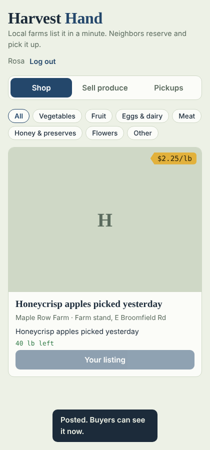

# Harvest Hand

A local farm-to-buyer marketplace for small farms in mid-Michigan. Farmers photograph their produce and get an AI-drafted listing with a suggested price. Neighbors browse, reserve an amount, and choose a pickup time. Farmers see who's coming and mark orders as picked up.

**Live demo:** https://harvest-hand.onrender.com (free hosting; the first load after a quiet period can take up to a minute, and demo data resets on restart)



## Features

- **AI listing assistant**: upload a photo plus a few words, and a multimodal LLM writes the title and description, picks a category and unit, and suggests a fair price range. If no API key is set or the call fails, it falls back to a rule-based price guide.
- **Marketplace**: browse by category, see stock left, and reserve from the farm's pickup slots.
- **Inventory integrity**: reservations run in a locked SQLite transaction, so two buyers can't both take the last items. Cancelling a reservation restocks the listing.
- **Accounts**: email and password sign-up with PBKDF2-SHA256 hashing and bearer-token sessions. Only a listing's seller can edit it, and only the seller can mark an order as picked up.
- **Mobile-first UI**: plain HTML, CSS and JavaScript, with light and dark themes.

## Tech stack

| Layer | Choice |
|---|---|
| API | Python, FastAPI, Pydantic |
| Data | SQLite (single file under `data/`) |
| AI | Anthropic Messages API (vision), rule-based fallback in `app/pricing.py` |
| Front end | Vanilla JS, CSS custom properties |
| Tests | pytest + FastAPI TestClient |

## Project layout

```
app/main.py      REST API: auth, listings, reservations, AI drafts
app/pricing.py   Rule-based price guide (fallback / baseline model)
static/          Front end
tests/           End-to-end API tests
```

## API

| Method | Path | Purpose |
|---|---|---|
| POST | `/api/signup`, `/api/login`, `/api/logout` | Accounts |
| GET | `/api/listings?category=` | Browse in-stock listings |
| POST | `/api/listings` | Create listing (multipart, optional photo) |
| PATCH / DELETE | `/api/listings/{id}` | Seller updates stock or price, or removes the listing |
| POST | `/api/reservations` | Reserve (atomic stock decrement) |
| GET | `/api/my/reservations` | Buyer and seller views |
| PATCH | `/api/reservations/{id}` | Mark picked up or cancel |
| POST | `/api/ai/draft` | Photo and notes in, structured listing JSON out |

Interactive docs are at `/docs` while the server runs.

## Run locally

Requires Python 3.10+.

**macOS:** double-click `Start Harvest Hand.command`. It creates a virtual environment, installs dependencies, and opens http://localhost:8000.

**Windows:** run `setup_windows.bat` once, then `run_windows.bat`.

**Manual:**
```bash
python3 -m venv .venv && source .venv/bin/activate
pip install -r requirements.txt
cp .env.example .env           # optionally add ANTHROPIC_API_KEY
uvicorn app.main:app --reload
```

Run the tests with `python -m pytest`.

## Deploy

On [Render](https://render.com): **New → Blueprint**, then select this repo. `render.yaml` sets everything up. Add `ANTHROPIC_API_KEY` in the service's Environment tab to turn on photo-based drafts.

On the free plan the database and photos reset when the service restarts, so treat it as a demo.

## Roadmap

- Replace the rule-based price guide with a regression model trained on real listing and sell-through data
- Deploy with PostgreSQL and object storage for photos
- SMS or email notifications to farmers when an order comes in
